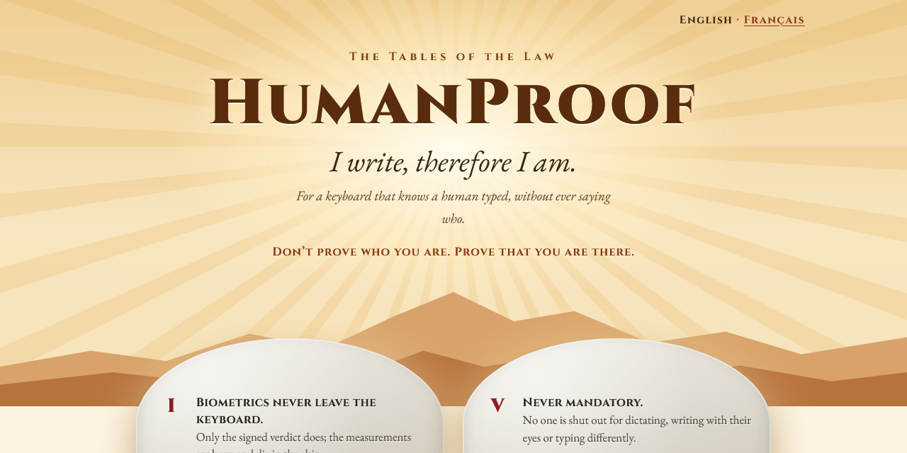

  

<b>I write, therefore I am.</b> · <i>J'écris, donc je suis.</i>

<a href="https://vpan-utbm.github.io/knock-knock/en.html"><b>Read the page</b></a> · <a href="https://vpan-utbm.github.io/knock-knock/"><b>Lire la page en français</b></a>

  — Knock knock. — Who's there? — A human. — A human who? — <b>None of your business.</b> 
  <i>— Toc toc. — Qui est là ? — Un humain. — Un humain qui ? — <b>Ça ne vous regarde pas.</b></i>

> **Don't prove who you are. Prove that you are there.**
> *Ne prouvez pas qui vous êtes. Prouvez que vous êtes là.*

HumanProof is a manifesto for a keyboard that certifies a text was typed by a human finger: liveness sensors in
the keys, a key sealed in the keyboard's chip, and a signature over the very text it typed. It proves that a
human typed the words and stands behind them, never who they are.

*HumanProof est un manifeste pour un clavier qui certifie qu'un texte a été tapé par un doigt humain : des
capteurs de vivant dans les touches, une clé scellée dans la puce du clavier, et une signature sur le texte même
qu'il a tapé. Il prouve qu'un humain a tapé ces mots et en répond, jamais qui il est.*

## The Tables of the Law · Les Tables de la Loi

| | Law | Loi |
| :-: | --- | --- |
| **I** | Biometrics never leave the keyboard. | La biométrie ne quitte jamais le clavier. |
| **II** | Anonymous by default. | Anonyme par défaut. |
| **III** | Identity only by choice. | L'identité seulement par choix. |
| **IV** | A refusal is never an accusation. | Un refus n'est jamais une accusation. |
| **V** | Never mandatory. | Jamais obligatoire. |
| **VI** | Open. | Ouvert. |
| **VII** | Proof of humanity is not a right. | Une preuve d'humanité n'est pas un droit. |

## Read · Lire

| | English | Français |
| --- | --- | --- |
| One page | [MANIFESTO-SHORT.md](MANIFESTO-SHORT.md) | [MANIFESTE-COURT.md](MANIFESTE-COURT.md) |
| Full manifesto, limits and references | [MANIFESTO.md](MANIFESTO.md) | [MANIFESTE.md](MANIFESTE.md) |
| The page | [vpan-utbm.github.io/knock-knock/en.html](https://vpan-utbm.github.io/knock-knock/en.html) | [vpan-utbm.github.io/knock-knock](https://vpan-utbm.github.io/knock-knock/) |

## Licence

The texts are licensed under [CC BY 4.0](LICENSE): copy, translate and adapt them freely, as long as you credit
the source and **indicate your changes**. The fonts of the page (Cinzel, EB Garamond, Cormorant) are
under the [SIL Open Font License 1.1](docs/fonts/).

*Les textes sont sous licence CC BY 4.0 : reprenez-les, traduisez-les, adaptez-les librement, en citant la source
et en signalant vos changements. Les polices de la page sont sous licence SIL OFL 1.1.*

The page has no script, no cookie, and loads nothing from elsewhere.

---

<b>Ideas belong to those who bring them to life.</b> <i>Les idées appartiennent à ceux qui les réalisent.</i>  — Human After All  <i>Written with the help of an AI, and that is precisely why this keyboard is needed.</i> <i>Écrit avec l'aide d'une IA, et c'est justement pour ça qu'il faut ce clavier.</i>

